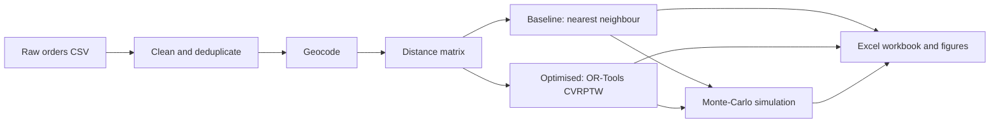

# Delivery Route Optimization using the Vehicle Routing Problem (VRP)

Plan delivery routes for a fleet of vans so that every customer is served inside their time window, no van is overloaded, and driving time and cost are as low as possible. The project takes a messy list of customer addresses all the way to a costed, simulated delivery plan and an Excel workbook that explains every number.

**Stack:** Python · Google OR-Tools · pandas / NumPy · openpyxl (Excel with live formulas) · matplotlib


> **Read this first.** The bundled customer data is **synthetic** (generated by the script, then saved as `data/sample_orders.csv`), cost rates and speeds are **assumptions**, and coordinates are **approximate locality centres**, not surveyed building locations. The savings below show what the method does on this sample, not a measured result for any real business. Run it on your own orders before quoting numbers. See [Limitations](#limitations).

## Contents
- [What the project does](#what-the-project-does)
- [Results on the sample data](#results-on-the-sample-data)
- [How it works](#how-it-works)
- [Quick start](#quick-start)
- [Command-line options](#command-line-options)
- [Repository layout](#repository-layout)
- [The Excel workbook](#the-excel-workbook)
- [Using your own data](#using-your-own-data)
- [Assumptions](#assumptions)
- [Testing](#testing)
- [Limitations](#limitations)
- [Possible extensions](#possible-extensions)
- [Further documentation](#further-documentation)
- [License](#license)

## What the project does

1. **Cleans** raw delivery addresses: standardises case and abbreviations (`Rd` → `Road`, `Nr` → `Near`), fixes misspelt localities (`Satacruz` → `Santacruz`), validates or corrects pincodes, and removes duplicate orders.
2. **Geocodes** each cleaned address to a latitude and longitude (offline approximation by default, optional online lookup).
3. **Builds a distance matrix** between the depot and all customers.
4. **Creates a baseline plan** with a nearest-neighbour rule, a stand-in for manual dispatch.
5. **Solves the Capacitated VRP with Time Windows (CVRPTW)** using OR-Tools to produce an optimised plan.
6. **Simulates both plans** 500 times each with random travel times, rush-hour slowdowns and random service times.
7. **Exports** an Excel workbook (live formulas, 10 sheets) and optional charts.

## Results on the sample data

53 customers after cleaning (56 raw rows, 3 duplicates removed), 1,851 kg total demand, 450 kg vans, one depot.

| | Baseline (nearest neighbour) | Optimised (OR-Tools) | Change |
|---|---:|---:|---:|
| Vehicles used | 5 | 5 | none |
| Distance (km) | 296.2 | 188.1 | −36.5% |
| Driving time (h) | 11.8 | 7.5 | −36.5% |
| Late deliveries, planned | 13 | 0 | −100% |
| Total daily cost incl. lateness penalty, planned (₹) | 23,615 | 13,376 | −43.4% |
| Daily cost, simulated mean of 500 runs (₹) | 24,633 | 13,630 | −44.7% |
| Late deliveries, simulated mean | 13.4 | 0.0 | −100% |
| On-time rate, simulated | 74.7% | 100% | +25.3 pts |


**How to read these numbers fairly**
- The baseline ignores time windows, which is why it is late so often. A dispatcher who plans around time slots would do better than this baseline, so real savings would be smaller.
- The optimised plan being late 0 times in all 500 simulated days is helped by slack: vans leave at 08:00 while most windows open at 09:00, so early arrivals simply wait. The optimised plan still contains about 14 hours of paid waiting. Departing later, or windows that open earlier, would reduce both the waiting and the safety margin.
- The solver stops on a time limit (20 s), so a re-run can produce a slightly different plan. Two runs during development gave optimised costs of ₹13,456 and ₹13,376.

## How it works



| Stage | Function in `vrp_delivery_optimization.py` | Summary |
|---|---|---|
| Clean | `clean_orders` | Regex pincode extraction, fuzzy locality matching (`difflib`), abbreviation expansion, pincode validation, de-duplication. Every row is logged. |
| Geocode | `geocode_all` | Locality centre from a built-in table plus a ±400 m offset (offline), or Nominatim with `--online`. |
| Distances | `distance_matrix` | Haversine distance × 1.3 road factor. |
| Baseline | `baseline_nearest_neighbour` | Greedy, capacity-aware, ignores time windows. |
| Optimise | `solve_cvrptw` | OR-Tools routing: capacity and time-window dimensions, Guided Local Search. |
| Evaluate | `evaluate_plan` | Deterministic timing, lateness and cost (mirrored by Excel formulas). |
| Simulate | `simulate_plan` | Lognormal travel noise, peak-hour factor, triangular service times. |
| Export | `build_excel`, `save_figures` | Workbook and PNG charts. |


This takes under a minute (the solver alone uses 20 s) and writes `output/VRP_Delivery_Optimization.xlsx` and three PNGs in `docs/images/`.

Excel formulas are saved without cached values by openpyxl. Excel and LibreOffice calculate them when you open the file, but some previewers (and pandas) will show blanks until the file has been opened and re-saved once. The copy committed in `output/` has already been recalculated.

Run without `--input-csv` to generate fresh synthetic orders instead.

## Command-line options

| Option | Default | Meaning |
|---|---|---|
| `--input-csv PATH` | synthetic data | Raw orders CSV (see [Using your own data](docs/USING_YOUR_OWN_DATA.md)) |
| `--out-dir DIR` | `output` | Where the workbook is written |
| `--figures-dir DIR` | off | Also save the three PNG charts here |
| `--solver-seconds N` | 20 | OR-Tools time limit |
| `--reps N` | 500 | Monte-Carlo replications per plan |
| `--seed N` | 42 | Random seed for data generation, offsets and simulation |
| `--online` | off | Geocode with OpenStreetMap Nominatim (untested in this project's environment) |
| `--export-sample-csv PATH` | off | Write the synthetic raw orders to a CSV and exit |

## Repository layout

```
vrp-delivery-optimization/
├── vrp_delivery_optimization.py    # the whole pipeline (CLI)
├── data/
│   └── sample_orders.csv           # 56 messy synthetic orders
├── output/
│   └── VRP_Delivery_Optimization.xlsx   # sample result, already recalculated
├── docs/
│   ├── METHODOLOGY.md              # technical write-up
│   ├── WORKBOOK_GUIDE.md           # sheet-by-sheet guide to the Excel file
│   ├── USING_YOUR_OWN_DATA.md      # CSV format, extending to other cities
│   └── images/                     # charts used in this README
├── tests/
│   └── test_pipeline.py            # 18 tests
├── requirements.txt
├── requirements-dev.txt
├── pytest.ini
├── LICENSE
└── README.md
```

## The Excel workbook

Ten sheets, 4,773 formulas, no formula errors after recalculation.

| Sheet | Purpose |
|---|---|
| Summary | Baseline vs optimised KPIs, saving, chart |
| Assumptions | Every parameter, with notes on where it comes from |
| Raw_Addresses | Cleaning log: raw text → cleaned text, with flags |
| Customers | Clean addresses, coordinates, demand, service time, time windows |
| Distance_Matrix | 54 × 54 road distances, live haversine formulas |
| Baseline_Legs / Optimized_Legs | Leg-by-leg arrival, waiting, service and lateness |
| Route_Summary | Per-route load, distance, time, lateness and cost |
| Sim_Replications | Raw output of the 500 simulated days per plan |
| Simulation_Results | Mean, standard deviation, 5th/95th percentile, on-time rate |

Changing speed, costs or the road factor on **Assumptions** recalculates the planned figures. The route orders and the simulation results are outputs of the Python script and only change when it is re-run. Details: [docs/WORKBOOK_GUIDE.md](docs/WORKBOOK_GUIDE.md).

## Using your own data

Provide a CSV with these columns (times as `HH:MM`):

```csv
address,demand_kg,service_min,tw_start,tw_end
"Flat 274, Falguni Plaza, Link Rd, Nr Metro Stn, lower parel, Mumbai 400013",46,15,13:00,18:00
```


Out of the box the cleaner knows **33 Mumbai localities**. Addresses outside that list are rejected and logged rather than guessed; to use another area, extend the locality table. The steps, including changing the depot and the cost parameters, are in [docs/USING_YOUR_OWN_DATA.md](docs/USING_YOUR_OWN_DATA.md).

## Assumptions

All of these are placeholders to be replaced with your real figures. They live in the `CFG` dictionary at the top of the script and are repeated on the workbook's Assumptions sheet.

| Parameter | Value |
|---|---|
| Departure from depot | 08:00; latest return 20:00 |
| Average speed | 25 km/h (off-peak) |
| Road distance factor | 1.30 × straight-line |
| Fuel and maintenance | ₹9 per km |
| Driver cost | ₹250 per hour (including waiting) |
| Fixed cost per vehicle used | ₹800 per day |
| Lateness penalty | ₹5 per minute |
| Vehicle capacity / fleet | 450 kg / 8 vehicles |
| Peak-hour travel-time factor | 1.4 (08:30–11:00 and 17:00–20:00) |
| Travel-time noise | lognormal, σ = 0.20 |
| Service-time multiplier | Triangular(0.8, 1.0, 1.6) |

## Testing

```bash
pip install -r requirements-dev.txt
pytest -q
```

The 18 tests cover address cleaning (abbreviations, misspellings, street-vs-locality, pincode repair, duplicates, rejection of unknown localities), the distance maths, CSV validation, and the optimiser (every customer visited exactly once, capacity respected, no late stops, shift end respected, beats the baseline). One end-to-end test runs the script and checks the workbook sheets and figures exist.

As a further check, the planned totals in the Excel formulas were compared with the independent Python calculation and agree.

## Limitations

- **Synthetic sample data.** Demands, service times and time windows are generated. Savings figures describe this sample only.
- **Approximate geocoding.** Offline coordinates are locality centres plus a random offset of about ±400 m, taken from a hand-typed table of 33 localities that has not been checked against an official source. Pincodes in that table were also typed by hand. The `--online` option exists but has not been tested.
- **Estimated distances.** Straight-line distance × 1.3, not real road distances. Production use needs a road-network engine (OSRM, Google Distance Matrix, etc.).
- **Weak baseline.** Nearest neighbour ignores time windows; compare against your real historical routes before claiming savings.
- **Heuristic optimiser.** Guided Local Search gives a good solution with no optimality guarantee, and results can vary slightly between runs.
- **Simulation scope.** Only travel-time and service-time randomness. No breakdowns, failed deliveries, or orders arriving during the day. The two plans are simulated with different random draws rather than shared ones.
- **Mumbai-specific out of the box.** The depot, locality table and address format are Mumbai-specific (see the guide for adapting).
- **Hard time windows.** The solver treats windows as hard limits and never plans a late delivery; if the fleet or day is too tight it reports no feasible solution instead of a plan with lateness.

## Possible extensions

- Real road distances and traffic-dependent travel times from a routing API.
- Multiple depots, mixed fleets, driver breaks, pickup-and-delivery.
- Re-optimisation when orders arrive during the day.
- Common random numbers in the simulation for a tighter plan comparison.
- Porting the simulation to a discrete-event tool such as AnyLogic or SimPy for animation and richer events. The Python simulation (`simulate_plan`) defines the logic to reproduce.


## License

MIT, see [LICENSE](LICENSE).
